<h2 data-importer="text" align="left">Hi ! I'm Shuvam(Eren)</h2>

###

###

 Hey, I'm Shuvam   Beginner Developer  Exploring AI/ML, Linux & Open Source  Learning C++, Python & Git  Building projects, one commit at a time Of course I will!.

###

  
  
  
  
  
  
  

###

SKILLS/CONT....

###

  
  
  
  
  
  
  
  
  
  
  
  
  
  
  
  
  
  
  
  
  
  
  
  
  
  
  

###

## CONTRIBUTION MAP

## CodeForces State

##

## LeetCode Stats

  

### 

<picture data-importer="pacman">
  <source media="(prefers-color-scheme: dark)" srcset="https://raw.githubusercontent.com/shuvamm939-glitch/shuvamm939-glitch/pacman-output/pacman-contribution-graph-dark.svg?game=pacman">
  <source media="(prefers-color-scheme: light)" srcset="https://raw.githubusercontent.com/shuvamm939-glitch/shuvamm939-glitch/pacman-output/pacman-contribution-graph.svg?game=pacman">
  
</picture>

###

  

###

[def]: https://codeforces-readme-stats.vercel.app/api/card?https://codeforces.com/profile/shuvamm939&theme=dark&border_color=63656e